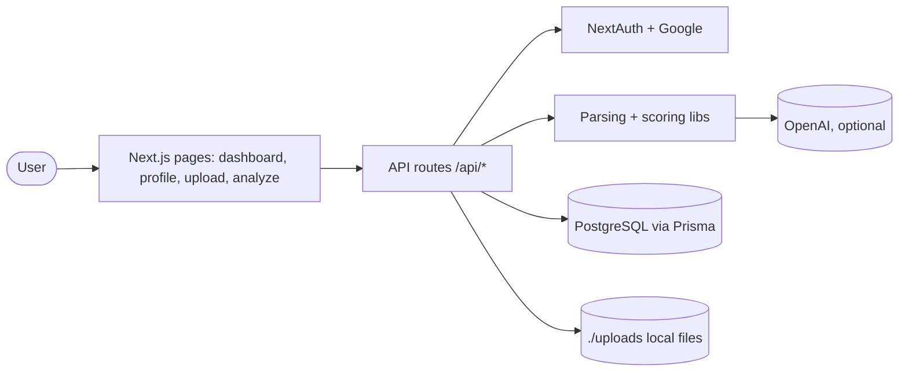
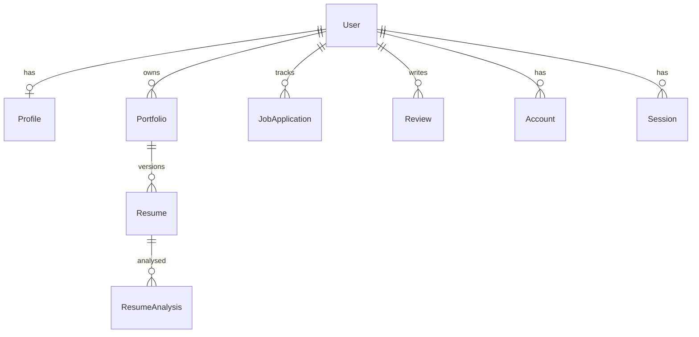

# Architecture

As found at onboarding (2026-11-01).

## Overview

Career Buddy is a single Next.js 15 app. A signed-in user uploads a resume (PDF/DOCX), pastes a job description, and gets a scored analysis across categories (match overview, required skills, work experience, education, impact, ATS compatibility, professional quality) with action items. An interactive view shows the resume PDF beside category details.

## System diagram

## Components

| Component            | Purpose                                                                       | Where                                                          |
| -------------------- | ----------------------------------------------------------------------------- | -------------------------------------------------------------- |
| Pages                | Dashboard, profile, upload, analyze, interactive analysis                     | `src/app/(app)/*`                                              |
| API routes           | auth, profile, resume upload/active/file/analyze/suggest, analysis categories | `src/app/api/**`                                               |
| Parsing              | text from PDF/DOCX                                                            | `src/lib/parse.ts`                                             |
| Scoring and feedback | skill matching, semantic matching, comprehensive scoring, category transform  | `src/lib/*.ts`                                                 |
| AI                   | OpenAI calls with mock fallback                                               | `src/lib/ai*.ts`, `semantic-match.ts`, `feedback-generator.ts` |
| UI                   | shadcn-style primitives and analysis panels                                   | `src/components/**`                                            |

Existing narrative docs: `docs/API.md`, `docs/PROJECT_STRUCTURE.md`, `docs/ONBOARDING.md`, `docs/INTERACTIVE_RESUME_ANALYSIS_PLAN.md`.

## Data model

## Cross-cutting concerns

- Auth: NextAuth, Google only, database sessions; each API route checks the session itself (no middleware).
- Logging: `src/lib/logger.ts`.
- Testing: Vitest, one test file (`src/lib/match.test.ts`).
- Deploy: none in the repo.
- PDF viewer: `src/components/resume-pdf-viewer.tsx` (react-pdf / pdf.js) needs browser globals such as `DOMMatrix`, so the interactive analysis page loads it with `next/dynamic` and `ssr: false` (skeleton while loading). See ADR 0007.
- Node: `^20.19 || ^22.13 || >=24` (`engines`, `.nvmrc`), required by jsdom for tests.
- Decisions: `docs/decisions/0001` to `0007`.
