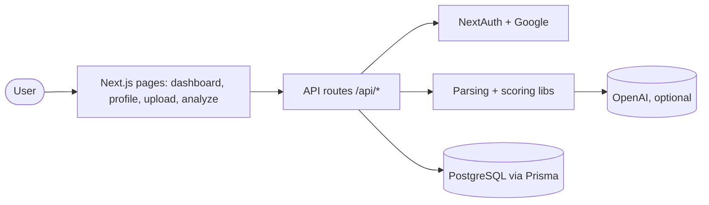
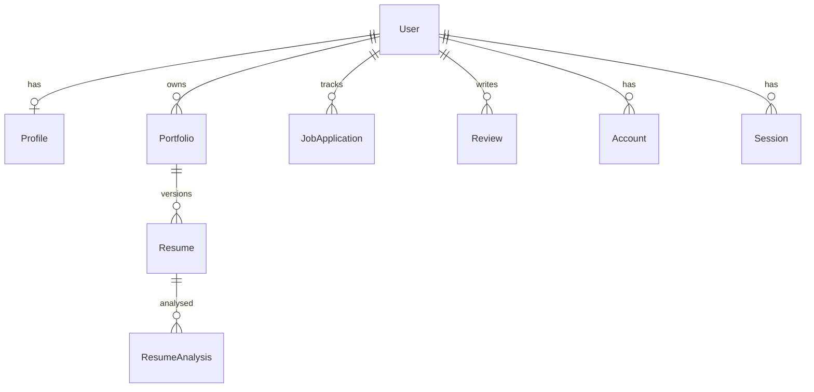

# Architecture

As found at onboarding (2026-11-01).

## Overview

Career Buddy is a single Next.js 16 app. A signed-in user uploads a resume (PDF/DOCX), pastes a job description, and gets a scored analysis across categories (match overview, required skills, work experience, education, impact, ATS compatibility, professional quality) with action items. An interactive view shows the resume PDF beside category details.

## System diagram

## Components

| Component               | Purpose                                                                              | Where                                                                              |
| ----------------------- | ------------------------------------------------------------------------------------ | ---------------------------------------------------------------------------------- |
| Pages                   | Dashboard, profile, upload, analyze, interactive analysis                            | `src/app/(app)/*`                                                                  |
| API routes              | auth, profile, resume upload/active/file/analyze/suggest, analysis categories        | `src/app/api/**`                                                                   |
| Parsing + upload checks | text from PDF/DOCX/TXT; size limit (5 MB, streamed) and content-based type detection | `src/lib/parse.ts`, `src/lib/upload-validation.ts`, `src/lib/read-limited-body.ts` |
| Scoring and feedback    | skill matching, semantic matching, comprehensive scoring, category transform         | `src/lib/*.ts`                                                                     |
| AI                      | OpenAI calls with mock fallback                                                      | `src/lib/ai*.ts`, `semantic-match.ts`, `feedback-generator.ts`                     |
| UI                      | shadcn-style primitives and analysis panels                                          | `src/components/**`                                                                |

Narrative docs: [API](api.md), [project structure](project-structure.md), [development setup](../development.md), [interactive analysis UI plan](../ux/interactive-analysis-plan.md).

## Data model

## Cross-cutting concerns

- Auth: NextAuth, Google only, database sessions; the sign-in screen is our own page at `/signin` (`pages.signIn`; `src/components/sign-in-card.tsx`), which only honours same-site `callbackUrl` values (`src/lib/callback-url.ts`; same-origin absolute URLs are reduced to path+search, anything else is dropped) and falls back to the Dashboard; every API route calls `guard()` from `src/lib/api-guard.ts` first, which returns the user id or a 401 (and a 429 for per-user rate limits, `src/lib/rate-limit.ts`, in memory per instance; signed-in and anonymous sign-in limits use separate bounded stores, and the sign-in address is read only behind `TRUSTED_PROXY=true`, ADR 0022). `src/app/api/api-guard.test.ts` fails if a route (other than NextAuth) does not call it. See ADR 0015 and 0022.
- Logging: `src/lib/logger.ts` is the single sink for server code (ADR 0017). `log` redacts free-text metadata; `logError` keeps only error class, code and status. `logger.test.ts` fails on any direct `console.*` in `src/lib` or `src/app/api`.
- Testing: Vitest (jsdom); unit tests beside `src/lib`, component tests (`*.test.tsx`, Testing Library) beside pages, see ADR 0021.
- CI: `.github/workflows/ci.yml` (lint, typecheck, test, build on PRs and main; Node from `.nvmrc`) beside `docs-check`, `security`, `audit`, `licences` (ADR 0013) and `quality` (axe accessibility and a first-load JS budget, no database; `playwright.config.ts`, `e2e/`, `scripts/perf-budget.mjs`; ADR 0012). Dependabot covers npm and Actions with a 7-day cooldown.

- Instances for parallel checks (the build-easy harness's own ADR 0014, not this repo's ADR 0014): `scripts/instance.sh` runs `next dev` on `$PORT`, refuses `NODE_ENV=production` (it sets a public dev auth secret), and keeps state private to `INSTANCE_ID` (default `port-$PORT`, sanitised to `[a-z0-9_]`, max 40 chars). Database: `career_buddy_<id>` on the local Postgres, derived from `DATABASE_URL` (env, `.env`, or the `.env.example` default; parsed by `scripts/instance-db.sh`, which accepts only host `localhost` or `127.0.0.1` and rejects `host=`/`hostaddr=`/socket query parameters; tested in `scripts/instance-db.test.ts`), created and migrated by `prisma migrate deploy` at start. Uploaded files live in `Resume.fileData` (ADR 0014), so they are per-instance with the database; `UPLOADS_DIR` (`src/lib/uploads.ts`) is only read for legacy files. Tear-down: `psql -h localhost -U postgres -c "DROP DATABASE \"career_buddy_<id>\""` (and `rm -rf uploads/<id>` if legacy files exist). OpenAI calls build their token/temperature parameters through `completionParams` (`src/lib/openai-params.ts`), which supports o-series and gpt-5 models (`max_completion_tokens`, no `temperature`).

- Deploy: none in the repo.
- PDF viewer: `src/components/resume-pdf-viewer.tsx` (react-pdf / pdf.js) needs browser globals such as `DOMMatrix`, so the interactive analysis page loads it with `next/dynamic` and `ssr: false` (skeleton while loading). See ADR 0007.
- Security headers: `next.config.ts` `headers()` applies the static ones from `src/lib/security-headers.ts` to every path (nosniff, referrer, frame denial, permissions policy, HSTS in production only, `Reporting-Endpoints`). The enforced `Content-Security-Policy` is built per request in `src/proxy.ts` with a fresh nonce (no `unsafe-inline` for scripts or style elements; `style-src-attr` keeps it for style attributes). Because a nonce cannot live in static HTML, the root layout calls `connection()` and every page renders per request. Violations POST to `src/app/api/csp-report/route.ts`, which logs a trimmed record. See ADR 0018.
- Node: `^22.22.2 || ^24.15 || >=26` (`engines`; `.nvmrc` tracks 22), required by jsdom 30 and lint-staged 17.
- Decisions: `docs/decisions/0001` to `0007`.
