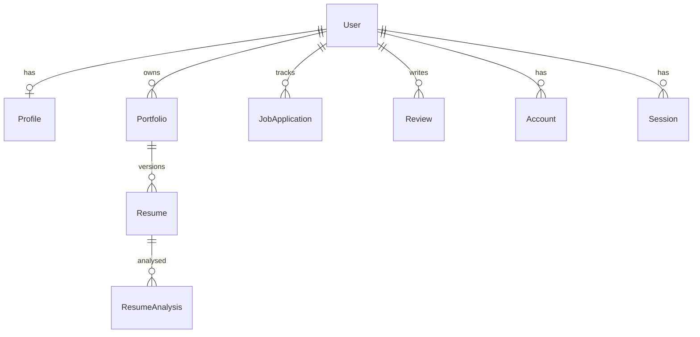

# Architecture

As found at onboarding (2026-11-01).

## Overview

Career Buddy is a single Next.js 16 app. A signed-in user uploads a resume (PDF/DOCX), pastes a job description, and gets a scored analysis across categories (match overview, required skills, work experience, education, impact, ATS compatibility, professional quality) with action items. An interactive view shows the resume PDF beside category details.

## System diagram

## Components

| Component            | Purpose                                                                       | Where                                                          |
| -------------------- | ----------------------------------------------------------------------------- | -------------------------------------------------------------- |
| Pages                | Dashboard, profile, upload, analyze, interactive analysis                     | `src/app/(app)/*`                                              |
| API routes           | auth, profile, resume upload/active/file/analyze/suggest, analysis categories | `src/app/api/**`                                               |
| Parsing              | text from PDF/DOCX                                                            | `src/lib/parse.ts`                                             |
| Scoring and feedback | skill matching, semantic matching, comprehensive scoring, category transform  | `src/lib/*.ts`                                                 |
| AI                   | OpenAI calls with mock fallback                                               | `src/lib/ai*.ts`, `semantic-match.ts`, `feedback-generator.ts` |
| UI                   | shadcn-style primitives and analysis panels                                   | `src/components/**`                                            |

Existing narrative docs: `docs/API.md`, `docs/PROJECT_STRUCTURE.md`, `docs/ONBOARDING.md`, `docs/INTERACTIVE_RESUME_ANALYSIS_PLAN.md`.

## Data model

## Cross-cutting concerns

- Auth: NextAuth, Google only, database sessions; each API route checks the session itself (no middleware).
- Logging: `src/lib/logger.ts`.
- Testing: Vitest, one test file (`src/lib/match.test.ts`).
- CI: `.github/workflows/ci.yml` (lint, typecheck, test, build on PRs and main; Node from `.nvmrc`) beside `docs-check`, `security` and `quality` (axe accessibility and a first-load JS budget, no database; `playwright.config.ts`, `e2e/`, `scripts/perf-budget.mjs`; ADR 0012). Dependabot covers npm and Actions with a 7-day cooldown.

- Instances for parallel checks (ADR 0014 in the harness): `scripts/instance.sh` runs `next dev` on `$PORT`, refuses `NODE_ENV=production` (it sets a public dev auth secret), and keeps state private to `INSTANCE_ID` (default `port-$PORT`, sanitised to `[a-z0-9_]`, max 40 chars). Database: `career_buddy_<id>` on the local Postgres, derived from `DATABASE_URL` (env, `.env`, or the `.env.example` default; parsed by `scripts/instance-db.sh`, which accepts only host `localhost` or `127.0.0.1` and rejects `host=`/`hostaddr=`/socket query parameters; tested in `scripts/instance-db.test.ts`), created and migrated by `prisma migrate deploy` at start. Uploads: `UPLOADS_DIR` (default `uploads/<id>/`, read by `src/lib/uploads.ts`). Tear-down: `psql -h localhost -U postgres -c "DROP DATABASE \"career_buddy_<id>\""` and `rm -rf uploads/<id>`. OpenAI calls build their token/temperature parameters through `completionParams` (`src/lib/openai-params.ts`), which supports o-series and gpt-5 models (`max_completion_tokens`, no `temperature`).

- Deploy: none in the repo.
- PDF viewer: `src/components/resume-pdf-viewer.tsx` (react-pdf / pdf.js) needs browser globals such as `DOMMatrix`, so the interactive analysis page loads it with `next/dynamic` and `ssr: false` (skeleton while loading). See ADR 0007.
- Security headers: `next.config.ts` `headers()` applies the static ones from `src/lib/security-headers.ts` to every path (nosniff, referrer, frame denial, permissions policy, HSTS in production only, `Reporting-Endpoints`). The enforced `Content-Security-Policy` is built per request in `src/proxy.ts` with a fresh nonce (no `unsafe-inline` for scripts or style elements; `style-src-attr` keeps it for style attributes). Because a nonce cannot live in static HTML, the root layout calls `connection()` and every page renders per request. Violations POST to `src/app/api/csp-report/route.ts`, which logs a trimmed record. See ADR 0018.
- Node: `^22.22.2 || ^24.15 || >=26` (`engines`; `.nvmrc` tracks 22), required by jsdom 30 and lint-staged 17.
- Decisions: `docs/decisions/0001` to `0007`.
