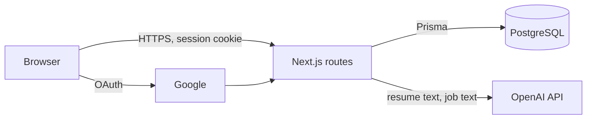

# Threat model

Short and current. Update it in any PR that changes what data the product
holds, where that data goes, or who can reach it. Written 2026-11-01 from
the code on `main`. Mitigations listed are ones that exist in code today;
everything else is under Open risks.

## What we protect

- **Resumes** (PDF/DOCX files and extracted text): names, contact details, employment and education history. The main asset; a leak harms the user.
- **Job descriptions, applications and analysis results**: reveal which jobs a person is pursuing.
- **Google identity and sessions** (`User`, `Account`, `Session` tables): a session token grants full access to one user's data. `Account` rows hold Google OAuth tokens.
- **Secrets**: `NEXTAUTH_SECRET`, Google client secret, `OPENAI_API_KEY`, `DATABASE_URL`. Server-side environment only.
- **OpenAI spend**: the API key can be drained by anyone who can call the AI routes.

## Entry points

| Entry point                                                                          | Trust boundary                                                                                                                        | Auth today                                                                                                                        |
| ------------------------------------------------------------------------------------ | ------------------------------------------------------------------------------------------------------------------------------------- | --------------------------------------------------------------------------------------------------------------------------------- |
| `POST /api/resume/upload`                                                            | Untrusted file (PDF, DOCX or anything else) parsed by `pdf-parse` and `mammoth`, stored in the database (`Resume.fileData`), max 5 MB | Session required                                                                                                                  |
| `GET /api/resume/[id]/file`                                                          | Reads a stored file named by a DB record                                                                                              | Session and ownership check                                                                                                       |
| `GET /api/resume/active`, `GET /api/resume/analysis/[id]/categories`, `/api/profile` | User data from the DB                                                                                                                 | Session required through the shared `guard()` (401 without one); queries scoped to the user                                       |
| `POST /api/resume/analyze`                                                           | Untrusted JSON (resume text, job description) which may be sent to OpenAI                                                             | Session required through `guard()` (401 without one) plus a rate limit of 10 calls a minute per user (429); body capped at 200 kB |
| `POST /api/resume/suggest`                                                           | Untrusted JSON sent to OpenAI                                                                                                         | Session required through `guard()` (401 without one) plus a rate limit of 10 calls a minute per user (429); body capped at 200 kB |
| `/api/auth/*`                                                                        | Google OAuth, NextAuth session cookie                                                                                                 | NextAuth                                                                                                                          |
| Environment                                                                          | Secrets from env                                                                                                                      | Not in the client bundle; `.env` is git-ignored, `.env.example` is tracked without values; gitleaks in CI                         |
| Third parties                                                                        | Google (sign-in), OpenAI (resume text leaves our servers), Google Fonts at build time                                                 | Terms in `licenses.md`                                                                                                            |

## Threats and mitigations

| Threat                                                            | Mitigation                                                                                                                                                                                                                                                                                                                           | Where (code / ADR)                                                               |
| ----------------------------------------------------------------- | ------------------------------------------------------------------------------------------------------------------------------------------------------------------------------------------------------------------------------------------------------------------------------------------------------------------------------------ | -------------------------------------------------------------------------------- |
| Account takeover or forged login                                  | Vetted provider (NextAuth with Google OAuth), no custom crypto, no password storage, database sessions that can be revoked                                                                                                                                                                                                           | `src/lib/auth.ts`, ADR 0003                                                      |
| Test login used to bypass sign-in in a real deployment            | No app route or provider exists for it: `scripts/test-login.mjs` writes a one-hour session row directly and refuses unless `TEST_LOGIN=true`, `NODE_ENV` is not production, and the database and `NEXTAUTH_URL` are local (database named `career_buddy*`, only allowlisted query params so `?host=` cannot redirect the connection) | `scripts/test-login-lib.mjs`, `scripts/test-login.test.ts`, ADR 0016             |
| One user reads another's resume file (IDOR)                       | File route loads the record and returns 403 when `portfolio.userId` differs from the session user                                                                                                                                                                                                                                    | `src/app/api/resume/[id]/file/route.ts`                                          |
| Anonymous access to stored data                                   | 401 without a session on the upload, file, active, categories and profile routes                                                                                                                                                                                                                                                     | `src/app/api/**/route.ts`                                                        |
| SQL injection                                                     | All DB access goes through Prisma (parameterised)                                                                                                                                                                                                                                                                                    | ADR 0002                                                                         |
| Secrets in the repo or client bundle                              | gitleaks in CI; secrets read only server-side                                                                                                                                                                                                                                                                                        | `security.yml`                                                                   |
| Known-vulnerable dependencies                                     | Next 16, Vitest 4, Zod 4, OpenAI 7 sweep; Dependabot weekly                                                                                                                                                                                                                                                                          | ADR 0008, `.github/dependabot.yml`                                               |
| Insecure code patterns                                            | Semgrep `p/default` in CI; full scan clean                                                                                                                                                                                                                                                                                           | `security.yml`                                                                   |
| Path traversal through the file name                              | The upload route writes no file and never touches disk (bytes go to `Resume.fileData`, ADR 0014); the legacy read path comes from the DB record, not the request, and is confined to `UPLOADS_DIR`                                                                                                                                   | `src/app/api/resume/[id]/file/route.ts`, `src/lib/uploads.ts`                    |
| Clickjacking, MIME sniffing, referrer and device-permission leaks | `X-Frame-Options: DENY` and CSP `frame-ancestors 'none'`, `nosniff`, `Referrer-Policy`, `Permissions-Policy` (camera, microphone, geolocation off), HSTS in production. CSP is enforced with per-request nonces (ADR 0018)                                                                                                           | `src/lib/security-headers.ts`, `src/proxy.ts`                                    |
| Header injection / open CORS on resume file download              | `Access-Control-Allow-Origin` removed (viewer is same-origin); file name sanitised and sent as `filename` plus RFC 5987 `filename*`                                                                                                                                                                                                  | `src/lib/content-disposition.ts`, `src/app/api/resume/[id]/file/route.ts`        |
| Anonymous or excessive use of paid OpenAI routes                  | `guard()` returns 401 before any work when there is no session, and 429 with `Retry-After` past 10 calls a minute per user; the oversized or invalid body is refused with 400. A test scans every route file so a new route cannot skip `guard()`                                                                                    | `src/lib/api-guard.ts`, `src/lib/rate-limit.ts`, `src/app/api/api-guard.test.ts` |
| Resume sent to OpenAI when not intended                           | `aiEnabled()` gates the calls; mock mode needs no key and sends nothing                                                                                                                                                                                                                                                              | `src/lib/ai.ts`, ADR 0004                                                        |
| Personal data leaking into logs                                   | Single logger drops free text and error messages; a test fails on direct `console` use in server code                                                                                                                                                                                                                                | `src/lib/logger.ts`, ADR 0017                                                    |

## Open risks

Known gaps, not mitigated yet. Each has an issue.

- **Upload handling (#36, mostly fixed):** uploads are capped at 5 MB (Content-Length pre-check, then a streaming byte count that cancels the body at the cap, so chunked bodies without Content-Length are bounded too, #107, ADR 0019; plus file size), the type is decided from content, and parser errors are not returned. Remaining: PDF and DOCX parsers still run on untrusted input inside the request process, and files are stored as plain `bytea` rows (encryption at rest is the database host's).
- **Rate limiting is per instance (#37, #112):** analyze and suggest (10 a minute), upload (10 a minute) and profile writes (30 a minute) are limited per user, sign-in POSTs (20 a minute) per client address; JSON bodies are capped (200 kB AI routes, 50 kB profile) and uploads at 5 MB. The counters are still in process memory, so several instances multiply the limit and a restart resets it; sign-in is limited per client address only when `TRUSTED_PROXY=true` (the proxy-appended, right-most `X-Forwarded-For` entry, or the configured hop count; never the client-written first entry), because otherwise the header is attacker-controlled: rotating it would bypass the limit, naming a victim would lock them out, and a shared bucket would let one client block everyone. Without a trusted proxy sign-in is not address-limited (Google handles the credentials; a POST only redirects); anonymous keys live in their own bounded store so flooding them cannot evict or reset signed-in users' counters (ADR 0022). A shared store is pending an owner decision (see #112).
- **No security event trail:** sign-ins, uploads and access are not recorded, so misuse cannot be investigated. Server logs are now free of personal data (#43, ADR 0017), but they do not yet record these events.
- **Shared dev state (#44, fixed):** each instance gets its own database (`career_buddy_<INSTANCE_ID>`) and uploads directory (`uploads/<INSTANCE_ID>/`); `scripts/instance.sh` refuses a `DATABASE_URL` whose parsed host is not exactly `localhost` or `127.0.0.1` (or that carries `host=`/`hostaddr=`/socket parameters). This is a dev-script safety check against creating databases on a remote server by mistake, not a security boundary: anyone who controls the environment can still run `prisma` against any database. The uploads directory is now read-only legacy storage: the upload route writes no files, and the file route confines any legacy path to `UPLOADS_DIR`.
- **Remaining audit findings (#7, #14 via #74, #75):** items ADR 0008 could not fix (for example `deepmerge-ts` through the Prisma 6 CLI, build time only).
- **No user data export or delete.** Required once accounts exist; needs a story before going public.
- **CSP residuals (#96):** the CSP is enforced with nonces. `style-src-attr 'unsafe-inline'` remains for React `style` attributes (cannot run script). Dev adds `unsafe-eval` and inline style elements for HMR only. `/api/csp-report` is public and unauthenticated by necessity (browsers send reports without cookies); it caps body size, keeps only a few trimmed fields and only logs, strips query and fragment from logged URLs and goes through the PII-safe logger (ADR 0017), and is limited by `publicGuard()` (declared Content-Length over 8 kB refused before reading) and `readBodyLimited()` (the body is read in chunks and cut off at 8 kB, so chunked bodies without a length cannot be buffered) to 8 kB and 60 reports a minute in total (one shared bucket, in memory per instance, ADR 0015); a flood is refused with 429 but can still crowd out genuine reports.
- **Encryption at rest** relies on the database host for rows; uploaded files are rows in the same database, so they get the same protection.
- **Prompt injection:** resume and job text go straight into OpenAI prompts. Output is shown only to the same user, so impact is low, but it is not validated beyond schema parsing where used.
