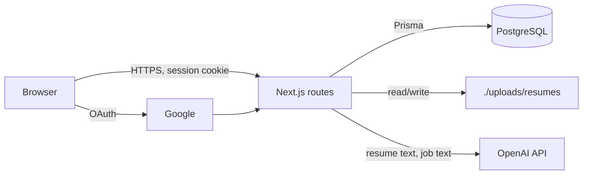

# Threat model

Short and current. Update it in any PR that changes what data the product
holds, where that data goes, or who can reach it. Written 2026-11-01 from
the code on `main`. Mitigations listed are ones that exist in code today;
everything else is under Open risks.

## What we protect

- **Resumes** (PDF/DOCX files and extracted text): names, contact details, employment and education history. The main asset; a leak harms the user.
- **Job descriptions, applications and analysis results**: reveal which jobs a person is pursuing.
- **Google identity and sessions** (`User`, `Account`, `Session` tables): a session token grants full access to one user's data. `Account` rows hold Google OAuth tokens.
- **Secrets**: `NEXTAUTH_SECRET`, Google client secret, `OPENAI_API_KEY`, `DATABASE_URL`. Server-side environment only.
- **OpenAI spend**: the API key can be drained by anyone who can call the AI routes.

## Entry points

| Entry point                                                                          | Trust boundary                                                                                 | Auth today                                                                                                |
| ------------------------------------------------------------------------------------ | ---------------------------------------------------------------------------------------------- | --------------------------------------------------------------------------------------------------------- |
| `POST /api/resume/upload`                                                            | Untrusted file (PDF, DOCX or anything else) parsed by `pdf-parse` and `mammoth`, saved to disk | Session required                                                                                          |
| `GET /api/resume/[id]/file`                                                          | Reads a stored file named by a DB record                                                       | Session and ownership check                                                                               |
| `GET /api/resume/active`, `GET /api/resume/analysis/[id]/categories`, `/api/profile` | User data from the DB                                                                          | Session checked in each route; scoping is per route, no central guard                                     |
| `POST /api/resume/analyze`                                                           | Untrusted JSON (resume text, job description) which may be sent to OpenAI                      | No session needed to run; the session only decides whether the result is saved                            |
| `POST /api/resume/suggest`                                                           | Untrusted JSON sent to OpenAI                                                                  | None                                                                                                      |
| `/api/auth/*`                                                                        | Google OAuth, NextAuth session cookie                                                          | NextAuth                                                                                                  |
| Environment                                                                          | Secrets from env                                                                               | Not in the client bundle; `.env` is git-ignored, `.env.example` is tracked without values; gitleaks in CI |
| Third parties                                                                        | Google (sign-in), OpenAI (resume text leaves our servers), Google Fonts at build time          | Terms in `licenses.md`                                                                                    |

## Threats and mitigations

| Threat                                      | Mitigation                                                                                                                                            | Where (code / ADR)                      |
| ------------------------------------------- | ----------------------------------------------------------------------------------------------------------------------------------------------------- | --------------------------------------- |
| Account takeover or forged login            | Vetted provider (NextAuth with Google OAuth), no custom crypto, no password storage, database sessions that can be revoked                            | `src/lib/auth.ts`, ADR 0003             |
| One user reads another's resume file (IDOR) | File route loads the record and returns 403 when `portfolio.userId` differs from the session user                                                     | `src/app/api/resume/[id]/file/route.ts` |
| Anonymous access to stored data             | 401 without a session on the upload, file, active, categories and profile routes                                                                      | `src/app/api/**/route.ts`               |
| SQL injection                               | All DB access goes through Prisma (parameterised)                                                                                                     | ADR 0002                                |
| Secrets in the repo or client bundle        | gitleaks in CI; secrets read only server-side                                                                                                         | `security.yml`                          |
| Known-vulnerable dependencies               | Next 16, Vitest 4, Zod 4, OpenAI 7 sweep; Dependabot weekly                                                                                           | ADR 0008, `.github/dependabot.yml`      |
| Insecure code patterns                      | Semgrep `p/default` in CI; full scan clean                                                                                                            | `security.yml`                          |
| Path traversal through the file name        | Stored name is `userId_timestamp_name` with characters outside `[a-zA-Z0-9.-]` replaced; the read path comes from the DB record, not from the request | `src/app/api/resume/upload/route.ts`    |
| Resume sent to OpenAI when not intended     | `aiEnabled()` gates the calls; mock mode needs no key and sends nothing                                                                               | `src/lib/ai.ts`, ADR 0004               |

## Open risks

Known gaps, not mitigated yet. Each has an issue.

- **Upload handling (#36):** no file size limit; no content verification (the type comes from the client `Content-Type`, and unknown types are decoded as text); PDF and DOCX parsers run on untrusted input inside the request process; the original name goes into `Content-Disposition` unescaped; the parser error message is returned to the client; files sit unencrypted on local disk.
- **No central auth and no rate limiting (#37):** per-route checks are repeated by hand, so a new route can forget one. `POST /api/resume/suggest` and `POST /api/resume/analyze` can be called without signing in and spend OpenAI budget. Nothing limits request rate or body size on any route, including sign-in.
- **Open CORS on the resume file response:** `Access-Control-Allow-Origin: *`. The route still needs the session cookie, so a cross-site read is unlikely, but the header is unnecessary (part of #36).
- **Test login (#38):** not built; when it is, it must be impossible to enable in production.
- **No audit logging (#43):** sign-ins, uploads and access are not recorded, so misuse cannot be investigated.
- **Shared dev state (#44):** instances share one `./uploads/` directory and need a per-instance database.
- **Remaining audit findings (#7, #14 via #74, #75):** items ADR 0008 could not fix (for example `deepmerge-ts` through the Prisma 6 CLI, build time only).
- **No user data export or delete.** Required once accounts exist; needs a story before going public.
- **No security headers or CSP** are configured in `next.config.ts`.
- **Encryption at rest** relies on the database host for rows; uploaded files have none until storage moves off local disk.
- **Prompt injection:** resume and job text go straight into OpenAI prompts. Output is shown only to the same user, so impact is low, but it is not validated beyond schema parsing where used.
